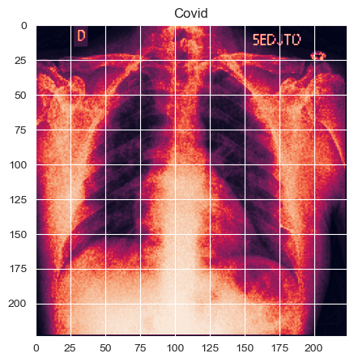
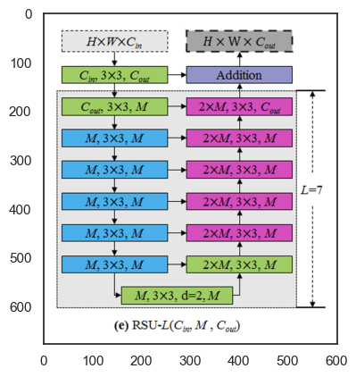

## The question

Chest X-rays are one of the cheapest, most common diagnostic images in medicine. This project asks which model is better suited to finding disease patterns in them after preprocessing: a convolutional neural network, or **U²-Net**, the nested U-structure network by Xuebin Qin et al. built from Residual U-blocks.

## What is inside

- Usage and configuration of **Residual U-blocks (RSU)**
- Construction of the **U²-Net** architecture from Residual U-blocks
- **Saliency probability maps** of input images, produced as side outputs of U²-Net
- Models trained on a **CUDA GPU**
- **Dropout** applied to the CNN model

## Data

The image dataset comes from Kaggle: [COVID-19 Image Dataset](https://www.kaggle.com/datasets/pranavraikokte/covid19-image-dataset?resource=download) with three classes, **Covid**, **Viral Pneumonia** and **Normal**. Download its `train` and `test` folders and use your working directory as the path in the `get_data` method (see [`Instructions`](Instructions)).

## Figures

<table>
<tr><td width="50%" valign="top"><br><sub>Training samples: Normal</sub></td><td width="50%" valign="top"><br><sub>Training samples: Viral Pneumonia</sub></td></tr>
<tr><td width="50%" valign="top"><br><sub>Training samples: Covid</sub></td><td width="50%" valign="top"><br><sub>A Covid X-ray rendered as an intensity map</sub></td></tr>
<tr><td width="50%" valign="top"><br><sub>The Residual U-block (RSU-L), figure from Qin et al., 2020</sub></td></tr>
</table>

## Run it

1. Download `spec-file.txt`.
2. Follow the instructions in `Conda_Virtual_Env.txt`:

```bash
# a new environment from the spec file
conda create --name myenv --file spec-file.txt
# or install the listed packages into an existing environment
conda install --name myenv --file spec-file.txt
```
The full set of environment commands is in [`Conda_Virtual_Env.txt`](Conda_Virtual_Env.txt).

Then open [`U2Net_and_CNN_model_comparison_for_Medical_Diagnosis.ipynb`](U2Net_and_CNN_model_comparison_for_Medical_Diagnosis.ipynb).

## Built with

`Python` · `pandas` · `NumPy` · `glob` · `Mahotas` · `Keras` · `Matplotlib` · `Seaborn` · `scikit-learn` · `scikit-learn classifiers` · `PyTorch` · `Torchvision`

<br>

<p align="center"><sub>Part of the work of <a href="https://github.com/johnnyk1090">Giannis Konteas</a> · end-to-end data science</sub></p>
